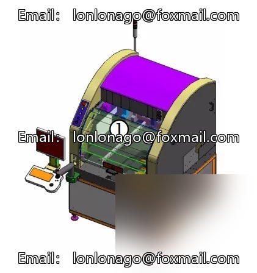
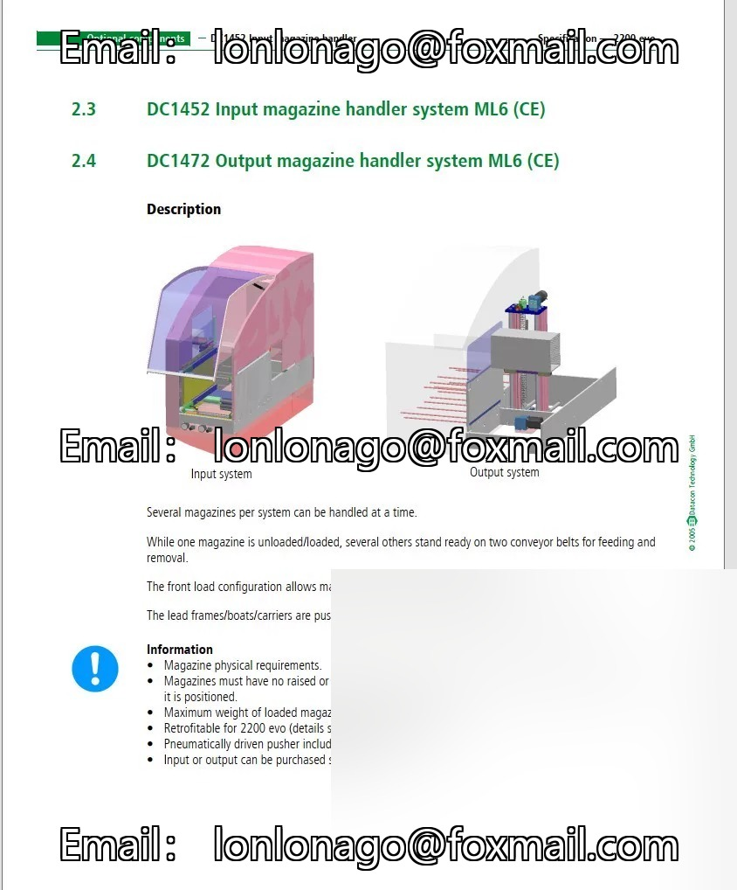
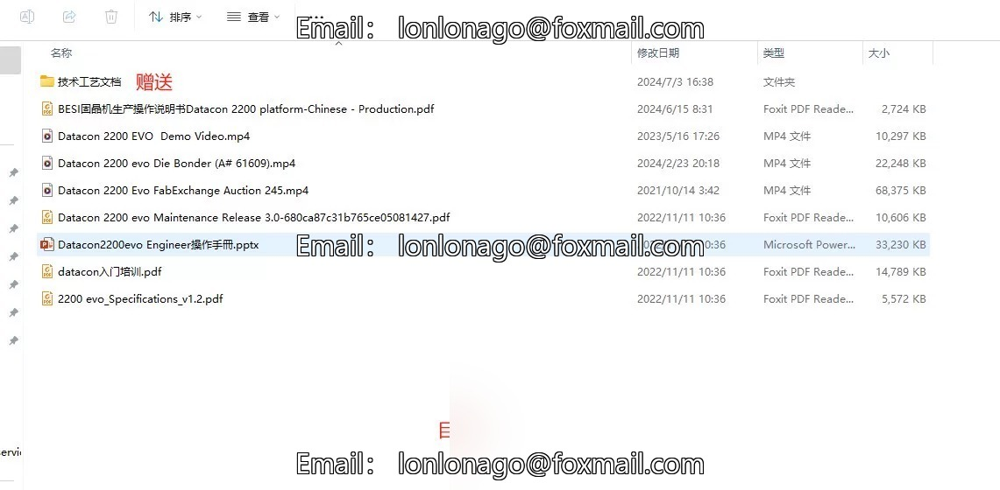
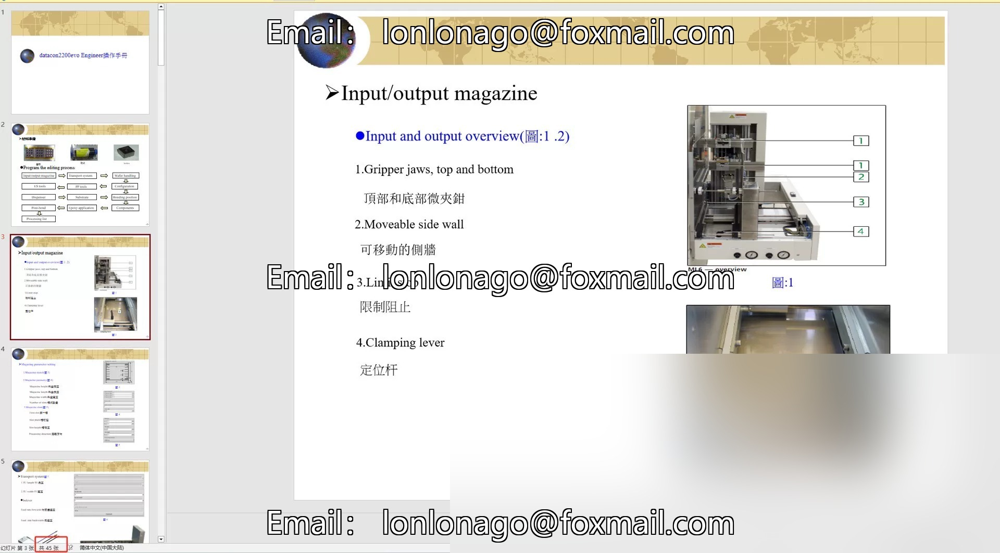
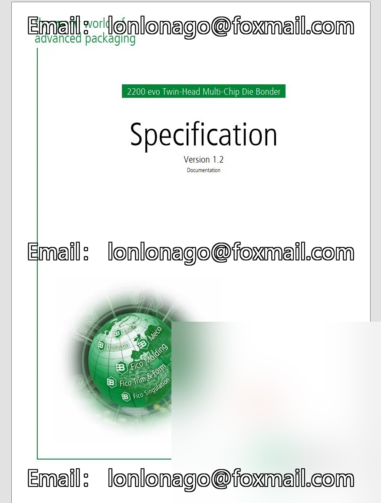
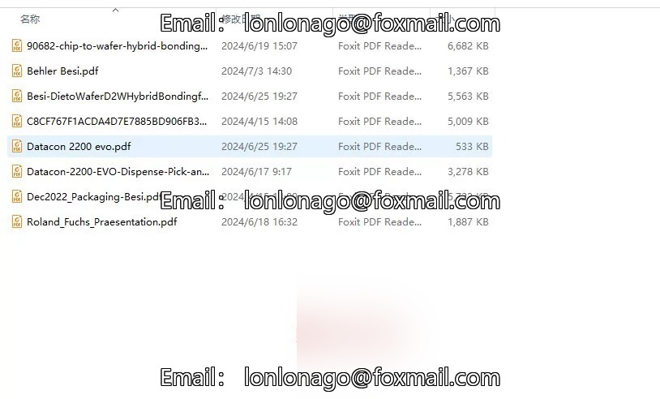
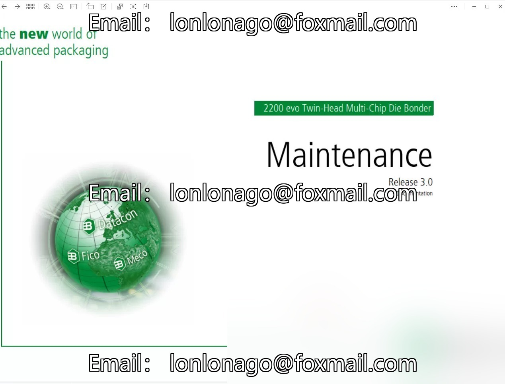
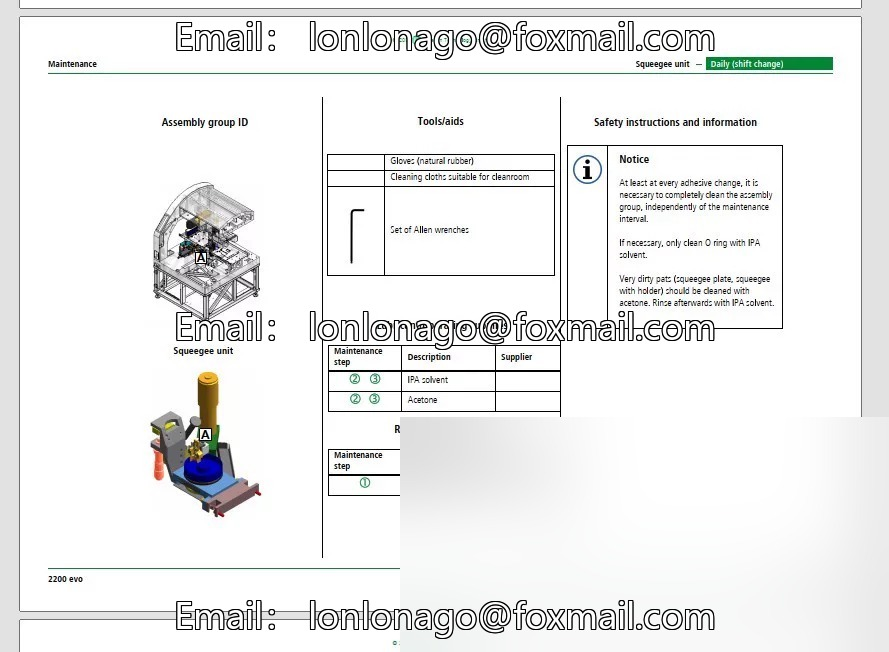

# BESI crystalizing machine data documentation Datacon2200evo various manuals and settings

## Body

BESI crystalizing machine documentation, Datacon2200evo various manuals and equipment operation video files are freely provided! With these documents, one can basically understand the structure and principles of BESI equipment; whether it is a designer or a production technical person, they can deeply study this technology!

The total folder has nearly 200MB

Take a photo and immediately send the electronic original file! The following images are screenshots of the file directory. Confirm before placing the order! Due to the replicability of electronic filing materials, So after purchase, returns are not allowed! Thanks for understanding!

The materials include BESI solid crystal machine operation manuals, equipment operation videos, process technical documents, and various manuals and settings; the total folder size is approximately 200M.

<!-- AI_ENRICHED -->

## Images

## Payment

Here is a pay link on Stripe ( https://buy.stripe.com/3cs8yP7sY87d0vu9AB ). Please contact me lonlonago@foxmail.com after funding $89, and I will send you a complete data files , thank you!

